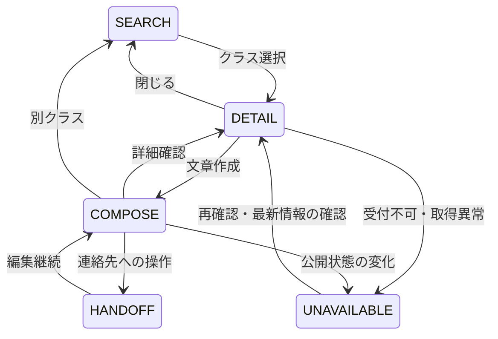

# RHYTHM SPEAKER｜公式Web UX・文言・ナビゲーション統合ルール v2.1

- Version: **2.1**
- Updated: 2026-11-01
- Status: **ACTIVE after PR #314 release**
- Repository: `noritap/rhythmspeaker` / `main` / GitHub Pages
- Origin: [SITEWIDE_COPY_POLICY_V1](SITEWIDE_COPY_POLICY_V1.md), [ECOSYSTEM_MENU_HIERARCHY_V1](ECOSYSTEM_MENU_HIERARCHY_V1.md), `docs/03_NAVIGATION_REGISTRY.md`, 会話で確認した予約・商店の分類
- Role: **WHAT THE USER SEES / HOW LINKS ARE NAMED AND PRIORITIZED**. Identity/ownership/security は `PROJECT_PROFILE.md` が優先し、共通開発方法は `AI_OS_CREATION_RULES` に委譲する。

## 0. One principle

> **通常は説明しない。例外は明示する。重要な条件は操作の直前に伝える。**

文章の短さだけを追求しない。初見の利用者が「何ができる・いくらかかる・次にどこを押す」を理解できることを優先する。

## 1. Sitewide naming contract

| Concept | Public label | Destination |
|---|---|---|
| 開催日程から受講を探す | **レッスン日程**（旧「通常クラス予約」） | `/schedule/` |
| 新しく始める | **初回体験 ¥1,000** | `/trial/` → `/trial/apply/` |
| クラスを説明する | **クラス紹介**（ナビ見出しは「クラス」も許容） | `/classes/` |
| レッスンの費用 | **料金**（ページ内「料金・通い方」は許容） | `/pricing/` |
| 独自制作商品を買う | **オリジナルグッズ**（旧「公式ショップ」/「SHOP」） | `https://rhythmspeaker.stores.jp/?all_items=true` |
| 商品を選びレビューを読む | **商品レビュー** / 補助ブランド「リズムスピーカー商店」 | `https://rhythmspeaker.hatenablog.com/` |
| 受講生の残高等 | **マイページ**（補足「RS Wallet」） | `https://tips-app-seven.vercel.app/` |
| 質問・予約連絡先 | **お問い合わせ** / **公式LINE** | `https://lin.ee/zC5YLe7` |

表記はリンク先の実際の機能と一致させる。店舗ブランド名を露出したい場合も、利用者が行える動詞（見る・予約する・買う・読む）を優先する。

## 2. Purpose-first hierarchy, not department-first menu

1. **P0** 最初の2大行動: `初回体験 ¥1,000`、`レッスン日程`。ページ上部の大カード2個。スマホ1列/PC2列。
2. **P1** レッスン・イベント: 教室、クラス、講師、料金、スタジオレンタル、ワークショップ。
3. **P2** 観る・聴く・学ぶ: 番組/動画、音楽、STEP等の学びへの入口。準備中は準備中を明示する。
4. **P2** 買う・選ぶ: `オリジナルグッズ` と `商品レビュー` を別リンク・別カードにする。購入先を記事メディアと混同させない。PCではオリジナル商品のカードをやや広めにする。
5. **P3** その他のご案内: 教室について、マイページ、公式LINE/メール問い合わせ。低優先＝無価値ではない。既存会員のアクセスはメニューからも維持。

旧9サービス入口を失わせず、記事メディアを独立追加して10カードにする。内部事業部門の数、英語の管理用番号、技術的な管理状態を公衆向けUIで強調しない。

## 3. Booking state and communication contract

- 公式カレンダー「レッスン296」に掲載したクラスは **開講決定済み**。掲載クラスの開講自体が仮決定であるような文言は禁止。
- `OPEN` / 状態未指定：参加の申し込みが可能。空席確約ではない。
- `CLOSE`：クラスは開講するが **追加受付なし**。「満席」「休講」「中止」と言い換えない。
- **参加予約はスタジオから明示的な「予約確定」返信をLINEまたはメールで送った時点で成立**。入力、コピー、LINE起動、送信だけでは成立しない。
- 上記の条件は申込画面・メッセージ作成時に表示。クラス一覧やページ冒頭に同じ注意書きを大量反復しない。
- カードでは開催日時・クラス・講師・例外ステータス・詳細への入口を優先。通常の「受付中」「未連携」「更新日時」の反復を避ける。
- `開催情報を再読み込み` は **公開済みGitHub Pages JSONの再取得のみ**。Googleカレンダーを即時再同期しない。秘密鍵やActions起動APIをブラウザに露出しない。定期同期は既存の安全なジョブ。
- 過去枠を将来の「参加可能枠」と誤表示しない。状況が確認できない場合は事実を超えて空席を断定しない。

## 4. Copy deletion / preservation

- **削る**: 見れば分かる操作説明、同一画面で重複するCTA補足、内部開発語句、管理ログ、「将来更新します」の反復、通常時のステータスバッジ。
- **残す**: 初回体験・通常料金・TIPS/チャージ条件・対象・期間・持ち物・場所・アクセス・先生の違い・連絡先。これらを削ると比較判断できなくなる。
- **例外は残す**: 中止・CLOSE・確定満席・取得失敗・準備中・権利未確認・外部リンク切れなど利用者の選択を変える情報。
- **保護領域**: 予約/変更/キャンセル/返金、個人情報、支払い、撮影、著作権、講師登録、ワークショップ運営、外部RS Walletなど。法的説明や安全注意を単なる冗長文として削除しない。
- アクセシビリティ情報は視覚的に隠してもスクリーンリーダーやキーボードで使えるよう維持する。

## 5. Unified navigation source / consistency

- **UIで参照する正式な名称とURLはこのv2と `docs/03_NAVIGATION_REGISTRY.md` を同一内容で維持する。**
- 主要メニューにある「レッスン日程」は `/schedule/`、オリジナルグッズは商品一覧へ。前者のURL名 `schedule` は変更しない。
- `tools/navigation_sync.py`、`tools/navigation_audit.py`、`scripts/build_sites_migration.cjs` と `docs/sites-migration/source-shell.txt`、公開HTML、SPA動的HTMLを同期する。
- グローバル共通メニューの順番と全リンクの維持は `RS-NAV-2` の変更規則に従い、販売・記事・レッスン日程を誤分類しない。
- HTML `<h2>` はサービスグループ、`<h3>` は各カード。タップ領域は十分に確保し、複数リンクのヒット領域が重ならない。
- PC/スマホの共通メニューは同一の正本から生成し、表示差・リンク先Driftを禁止する。

## 6. Release gate

- 最新main/PR/保護ファイル境界/差分を先に確認する。
- 重要文言とリンクの契約テスト、生成結果のゼロ差分、ナビゲーションstrict、静的/JS両描画の整合を検証。
- 320/375/390/430/768/1440px、コンソール、画像、横スクロール、タップ、キーボード、戻る操作を検証。
- GitHub Pages `main` にPRで安全に統合し、公開デプロイ成功と実際のページを再確認。
- 変換率・売上等は実測データなしに改善を断定しない。採点は専門家による暫定評価と実測評価を分ける。
- クラス同期、ワークショップDB/Auth、個人情報、課金・外部ショップ/ブログの中身を変更しない。

## 7. Rule hierarchy and maintenance

1. `PROJECT_PROFILE.md`: identity, system boundary, protected areas.
2. `AI_OS_CREATION_RULES`: universal development/QA process.
3. `docs/ux/RS_WEB_UX_RULES_V2.md`: **canonical user-facing UX writing / naming / prioritization**.
4. `docs/03_NAVIGATION_REGISTRY.md`: actual menu destination/order contract.
5. Page-specific content/feature contracts and tests.

v1 documents are history/reference. Do not create another contradictory independent "copy rule"; edit v2 and synchronize associated tests when changing terminology or priority.

## 8. Next improvement backlog (not automatically part of this release)

- レッスン日程の長い一覧を直近優先で段階表示。
- 過去枠申込を防ぐ明示的な時間ガード。
- 新規利用者による3〜5件の課題完了テスト。
- 商品一覧URLの外部導線の定期確認。

## 9. Header menu v3 — 2026-11-01（統合）

### Purpose-first ranking

- **P0：レッスン日程／初回体験 ¥1,000**。タップ頻度・継続収益と新規継続獲得の主要入口。メニュー最上部に大ボタンで独立配置する。売上・LTVの順位は仮説であり実測ではない。
- **P1：教室・レッスン**。料金、クラス紹介、講師紹介、ワークショップ、アクセス、スタジオレンタルを2列の中型リンクへ。
- **P1：会員・お問い合わせ**。RS Walletのマイページと公式LINEは予約・変更・残高確認の継続利用のため独立グループ。
- **P2：その他のページ**。教室トップ、教室紹介、FAQ、Rhythm Speaker Show、オリジナルグッズ、すべてのサービスはコンパクトな2列。レビュー記事・番組・音楽などの全サービスは専用ページで網羅する。
- **Self-navigation**：現在のページへのリンクはメニューから外す。特に `/ecosystem/` で「すべてのサービス」を二重表示しない。

### UI interaction / accessibility

- メニューは1つの意味的な `nav` に統合し、Desktop/Mobile用の重複DOMを作らない。共通10リンクの行き先は全て残す（現在ページのみ非表示）。
- 状態は `aria-expanded`・`aria-label`・開閉アイコン（＋→×）を同期。開いたときリンクへフォーカス、Escapeで閉じてトリガーへフォーカスを戻す。
- メニューの表示高さが不足する画面では内部スクロールを提供する。画面外のリンクを操作できなくしない。
- 320/375/390/430/768/1440pxで横スクロール・タップ領域・キーボード・実リンクを検証する。
- `tools/navigation_sync.py` をメニューの唯一の生成正本とし、`tools/navigation_audit.py --strict` およびPR上のゼロ差分テストで維持する。静的生成は完了後にメニュー同期を実行する。
- ブランドロゴの遷移先変更は、サイト全体のホーム動線への影響があるため別のUXレビュー事項とする。今回の変更では据え置く。

### Safety boundary

- 予約成立はスタジオからの「予約確定」LINE/メール返信後。メニューのクリックは申込・入金・予約成立を意味しない。
- 料金・個人情報・決済・ワークショップ認証・開催確定状態・カレンダー同期に触れない。

## 10. Reservation UX v3 — 2026-11-02（/schedule/への統合）

- 状態: SEARCH → DETAIL → COMPOSE → HANDOFF。取得失敗・遅延・CLOSE/CANCELLED/INQUIRY_ONLY・公開情報消失・確定人数による定員到達・開始後はUNAVAILABLE。HANDOFFは連絡先への操作であり、アプリ起動・送信・予約成立の確認ではない。
- DETAILの補足は同一モーダルのdetails。COMPOSEは選択要約、編集文章、コピー、LINE、メール、予約成立条件。詳細・別クラス・閉じるは低優先度。
- クラス別draftはタブ内メモリのみ。URL・永続storage・analytics・ログへ文章を保存しない。同じクラスへ戻る/履歴移動で保持。別クラスへは流用しない。日時/担当などの変更時は通常申込を止め、明示確認後に新しい文章へ作り直す。
- コピーはclipboard Promise成功後だけ成功表示。編集後はコピー済み表示を解除。失敗時は文章を選択して手動コピーを案内。LINEへのアクセスはコピー失敗でも維持。メール本文は最新編集文。
- 公開JSON再取得は初回、5分間隔（可視時のみ）、タブ再表示、必要時の連絡前。自動確認は60秒以上間隔・同時1件・再試行を含み1時間20件まで・10秒timeout。Googleカレンダー同期や復旧ジョブは起動しない。
- 通常時の再読込ボタンは非表示。異常時のみ「もう一度確認する」。取得失敗は古いOPENの通常申込を止めて相談窓口へ。再取得で編集中文章を自動置換しない。
- 履歴はclass/stepと検索状態のみ。直接URLを維持。閉じる/Escapeで元の位置と操作対象へ戻す。モバイルは固定CTAを重ねず通常スクロール、textarea16px以上、可視フォーカス・状態live通知を維持。
- 変更範囲は申し込みUXと必要テスト。独立監視のG1完成とは区別。効果は実測するまで仮説。

HANDOFFの次の送信と予約確定返信は外部で行われ、サイトからは検証できない。

## 11. Sitewide Journey UX v1 — 2026-11-02（公開導線の目的保持）

- 適用目的: 各ページで利用者が選んだクラス種別・担当講師・料金プラン・レンタル方式を、次の問い合わせ・開催日程確認へ可能な限り保持する。全ページを予約モーダル化しない。
- 初回体験申込 `/trial/apply/` は入力中の補足情報確認を `details` で同一画面内に提供。入力氏名・メッセージをURL・analytics・永続storageへ保存しない。
- `/classes/*/` から `/schedule/?type=...` へ移動。既存の `?class=<session-id>` は予約対象の**開催枠ID**のため、クラス種別に流用しない。認識できないtypeは無視する。
- `/instructors/*/` から `/schedule/?teacher=...` へ移動し、講師検索を初期設定。問い合わせ・予約確定ルールは従来どおり。
- 料金・レンタルの個別相談は、選択したプラン名を含むLINE下書きを提供する。リンク起動は送信・予約・決済を意味しない。Walletや価格の条件を自動変更しない。
- `/workshops/` の自己リンクをページ内の開催情報検索へ置換する。Workshop Managerの実予約フォーム、Supabase/RLS/個人情報・キャンセル処理には触れない。
- `tools/test_sitewide_journey_ux.cjs` と専用CIで差分の契約を検証。サイト移植監査は不変の基準hashを保持し、今回変更した保護HTMLのみ `docs/sites-migration/approved-content-revisions.json` にGit Blob SHAを明示して監査する。
- 実ブラウザ操作・LINEの外部アプリ動作・予約率向上は、単体契約CIがPASSしても独立した受入検証を必要とする。

## 12. Reading navigation supplement (2026-11-05)

- 右上の単一共通メニューに「読みもの」2リンクを追加する：`タップダンスを学ぶ`（教育ブログ）と `商品レビューを読む`（商店記事）。
- 体験・日程のP0と料金・講師等の教室導線は変更しない。記事メディアを体験申込み・物販購入と混同させない。
- `/ecosystem/` のLEARNカードには教育ブログへの補助リンクを追加し、元の基礎案内と10カードを保持する。
- STORESの `オリジナルグッズ` は自社販売先、商店ブログの `商品レビューを読む` は読みものとして区別する。
- 静的HTMLと `assets/ux-lab/app.js` の再描画が食い違わないよう両方を更新し、ブラウザキャッシュ用のJSバージョンを更新する。

## 13. 3VC menu discovery (2026-11-05)

- メニューは「よく使う」「教室・レッスン」「観る・聴く・学ぶ」「買う・選ぶ」「会員・お問い合わせ」「その他のページ」の6分類。
- 既存のP0予約行動・内容・URLは不変。番組・音楽・教育記事はメディア群、商品購入と商品レビューは区別した買い物群に配置。
- 記事メディアのリンクは本番として確認済みのURLのみ使用し、外部サイトの公開記事数をメニューで断定しない。
- 共通ソース生成・CSSキャッシュ更新・320/375/390/430/768/1440pxの回帰検査を行う。

## 14. Menu compactness and reopen UX (2026-11-05)
- Right-header menu is for complete service discovery; the compact desktop header remains the fast-access area for schedule, pricing, classes, instructors and access.
- Keep all six menu groups, all destinations, and a single shared navigation DOM on PC and mobile.
- Reduce wasted vertical spacing without shrinking general link hit targets below 44px. Keep internal scrolling when viewport height is short.
- Reopening the menu restores its scroll position to the beginning so schedule and trial actions remain the first choices. Escape closes and returns focus to the toggle.
- Verify six responsive widths and both CSS and shared JS rendering with cache busting on the ten main pages.

## 15. Rental studio photo-first UX (2026-11-05)
- 一般のレンタルスタジオ利用者を第一に、写真、時間料金、利用用途、設備、予約の順に理解できるページを構成する。
- STARTER SUPPORTは差別化サービスとして残し、`/rental/#starter` を互換維持。詳細条件は折りたたみ、元の30%計算、Floor Time、月間枠、Zero-Profit運用の意味を維持する。
- 練習・撮影・WS等は利用希望を確認して適用。料金3,500 TIPS/1時間と、RS利用料0円が企画全体の赤字保証ではないことを正確に書く。
- 施設の未測定寸法・定員、未承認の備品や音響利用を断言しない。写真24枚と動画のGitHub保存ステータスは`rental/media-intake.json`で管理。実ファイルがGitHubに揃うまで壊れたsrcは出さず、既存の確認済み実写真を使う。
- CTAは予約を即時確定したように見せない。スタジオからの明示的な確認をもって予約確定とする。
- 本番公開後も320/375/390/430/768/1440px・画像404・メニュー・写真拡大・LINEリンクの回帰検証を必須とする。
